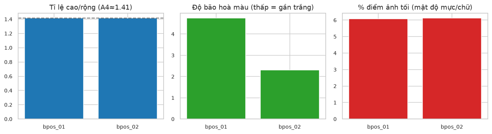
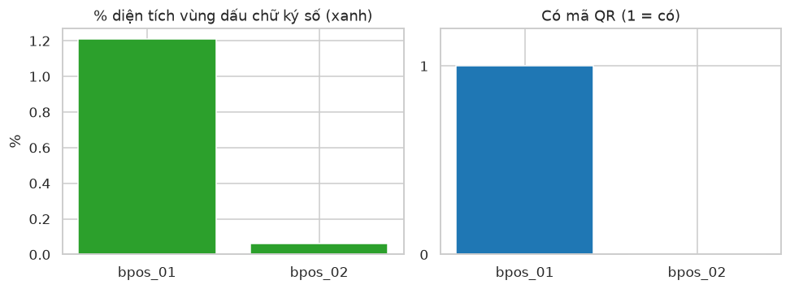
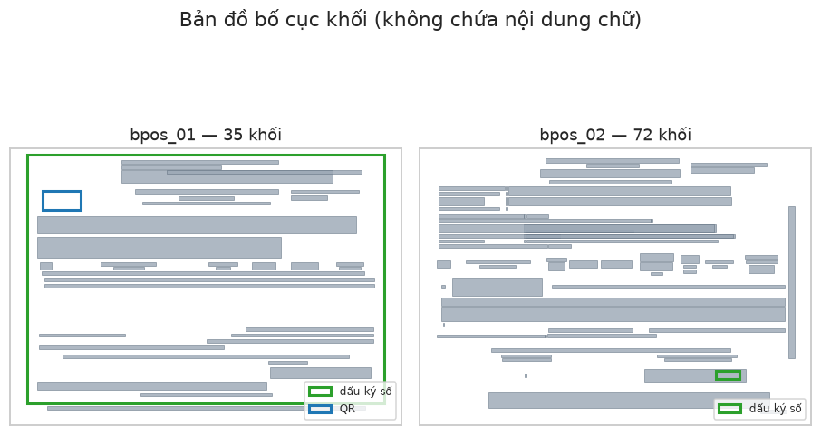
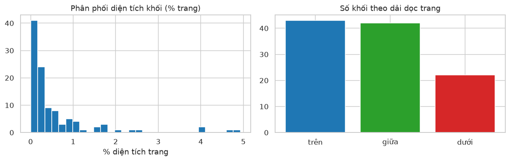

# Dữ liệu ảnh — hoá đơn điện tử (EDA cấu trúc, không lộ dữ liệu nhạy cảm)

**Nhóm T&D** · Trần Hữu Anh Triết (2470745), Ngô Minh Đại (2470722)

**Học phần:** Nền tảng lập trình cho phân tích và trực quan dữ liệu · Học kỳ 261, năm học 2026–2027 · Giảng viên Lê Thành Sách

Checkpoint này khảo sát **cấu trúc ảnh hoá đơn điện tử** để chuẩn bị cho bài toán phân loại/kiểm tra ảnh. Vì hoá đơn chứa thông tin nhạy cảm (mã số thuế, tên công ty, số tiền), repo công khai **không chứa ảnh gốc**; notebook chỉ dùng đặc trưng số và toạ độ đã trích sẵn. Nhờ vậy Run-all trên Colab tái lập mọi biểu đồ mà không cần ảnh và không lộ dữ liệu.

**Liên kết:** [Notebook trên GitHub](https://github.com/tobitran17-art/CO5177/blob/main/notebooks/image_eda.ipynb) · [Mở trên Google Colab](https://colab.research.google.com/github/tobitran17-art/CO5177/blob/main/notebooks/image_eda.ipynb) · PDF report và video trình bày sẽ cập nhật.

## 1. Bài toán và phạm vi

Hướng tới **phân loại/kiểm tra ảnh hoá đơn điện tử** (ví dụ: có mã / không mã cơ quan thuế; có / không chữ ký số). Checkpoint này làm EDA cấu trúc ảnh: độ phân giải, màu, vùng chữ ký số, mã QR và bố cục khối văn bản — những đặc trưng mà mô hình ảnh sẽ dùng.

## 2. Dữ liệu

Nguồn: hoá đơn điện tử của BPOS. **Không commit ảnh gốc** lên repo công khai; chỉ commit đặc trưng đã trích — mỗi hoá đơn một dòng số liệu (`invoice_features.csv`), mỗi khối văn bản một dòng toạ độ chuẩn hoá 0..1 (`invoice_blocks.csv`), không chứa nội dung chữ. Trích bằng `PyMuPDF` + `OpenCV`.

## 3. Đối chiếu ràng buộc và khoảng cách

| Tiêu chí | Yêu cầu | Hiện tại | Trạng thái |
| --- | --- | --- | --- |
| Số ảnh | ≥ 5.000 | 2 (khởi đầu) | Chưa — cần thu thập thêm |
| Số lớp | ≥ 3 | chưa gán nhãn lớp | Chưa |
| Độ phân giải | cạnh ngắn ≥ 128 px | cạnh ngắn ~1.653 px | Có |
| Không lộ PII | repo công khai | chỉ đặc trưng số | Có |

**Kế hoạch mở rộng để đạt ≥ 5.000 ảnh / ≥ 3 lớp:** thu thập thêm hoá đơn (ẩn danh PII trước khi lưu), gán nhãn theo tiêu chí nghiệp vụ — có mã / không mã cơ quan thuế, có / không chữ ký số, có / không QR — và augmentation hợp lý (xoay nhẹ, nhiễu scan, đổi độ sáng) để mô phỏng ảnh chụp/scan thực tế.

## 4. Thuộc tính ảnh

Hoá đơn render ra ảnh gần như **trắng** (độ bão hoà rất thấp 2–5/255, độ sáng ~241/255), tỉ lệ A4 dọc (~1,41).

**Kết luận.** Đặc điểm "tài liệu nền trắng, tỉ lệ A4" giúp phân biệt với ảnh chụp giấy. `bpos_02` nhiều chữ hơn nên % điểm tối và số khối văn bản cao hơn.

## 5. Dấu chữ ký số và mã QR

Phần mềm hoá đơn thường vẽ **con dấu chữ ký số màu xanh** và/hoặc **mã QR**.

**Kết luận.** `bpos_01` có dấu chữ ký số (1,2% diện tích vùng xanh) và mã QR; `bpos_02` gần như không có vùng xanh và không QR. Ngay hai mẫu đã khác rõ → hai đặc trưng này hợp làm **tiêu chí gán nhãn** khi mở rộng tập.

## 6. Bố cục khối văn bản

Vẽ lại bản đồ khối từ toạ độ đã trích (không có nội dung chữ): ô xám là khối văn bản, khung xanh lá là vùng dấu chữ ký số, khung xanh dương là QR.

**Kết luận.** Cấu trúc hai hoá đơn gần giống nhau (khối tiêu đề ở trên, bảng hàng hoá ở giữa, tổng tiền và dấu chữ ký số ở dưới) → bố cục là đặc trưng ổn định cho mô hình.

## 7. Phân phối khối văn bản

Gộp **107 khối** từ các hoá đơn để nhìn phân phối kích thước và vị trí — dữ liệu phong phú hơn số lượng ảnh.

**Kết luận.** Đa số khối nhỏ (< 1% diện tích trang) là dòng chữ; khối lớn là bảng/tiêu đề. Khối tập trung ở nửa trên trang (thông tin bên bán/bên mua).

## 8. Phần chưa làm

- Thu thập thêm hoá đơn (ẩn danh PII) để đạt ≥ 5.000 ảnh và ≥ 3 lớp, gán nhãn theo tiêu chí nghiệp vụ.
- Chia train/val/test tránh rò rỉ (không để cùng một hoá đơn sang nhiều tập).
- Trích đặc trưng bằng mô hình pretrained (feature extractor) so với đặc trưng thủ công OpenCV.
- Confusion matrix kèm mẫu bị gán sai.
