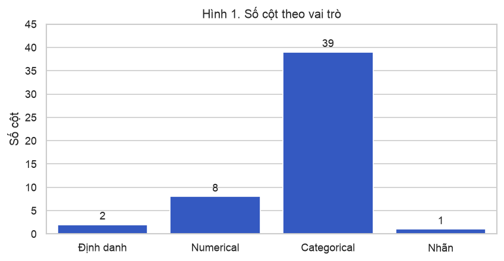
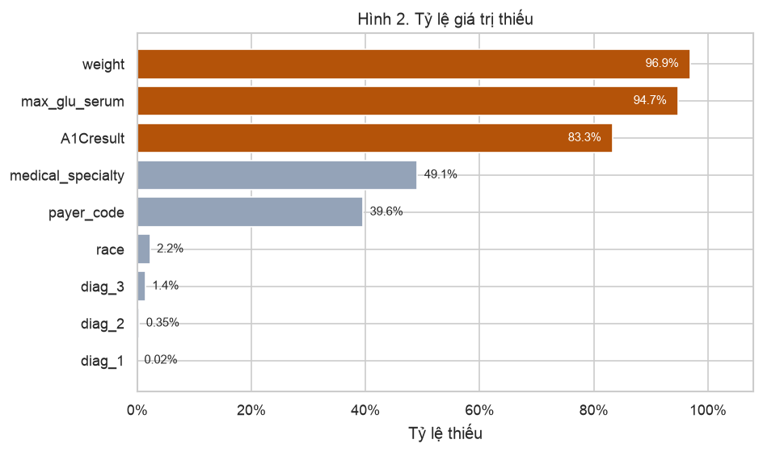
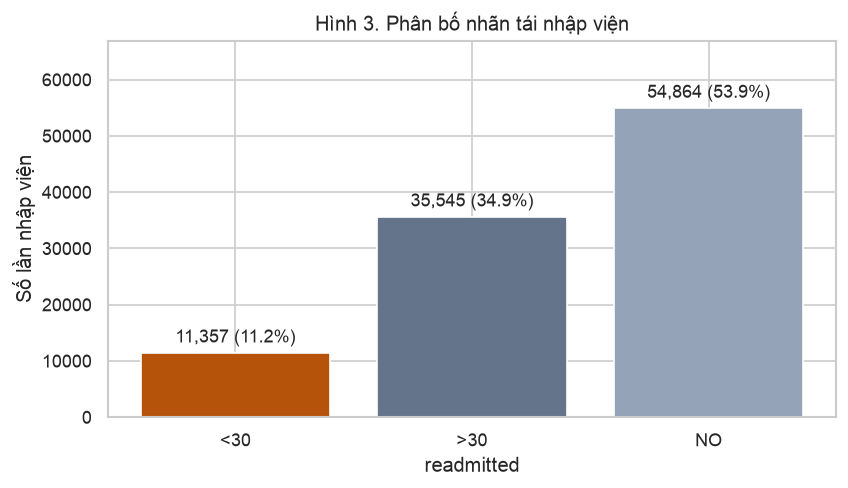
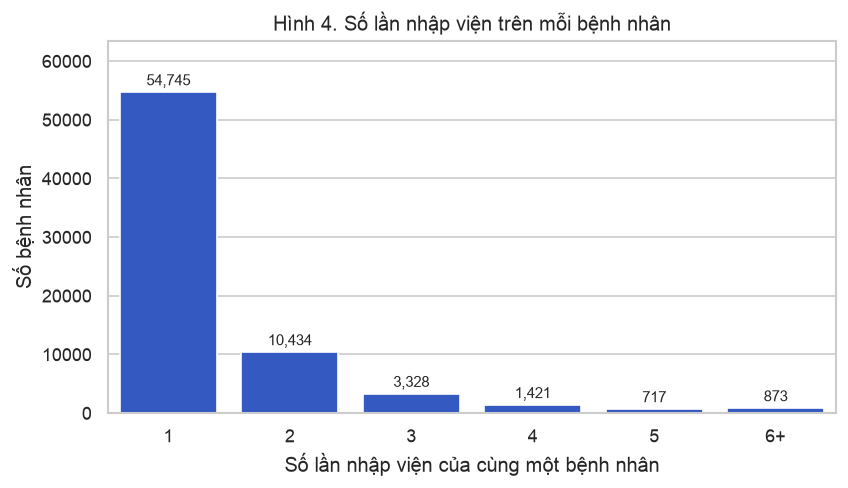
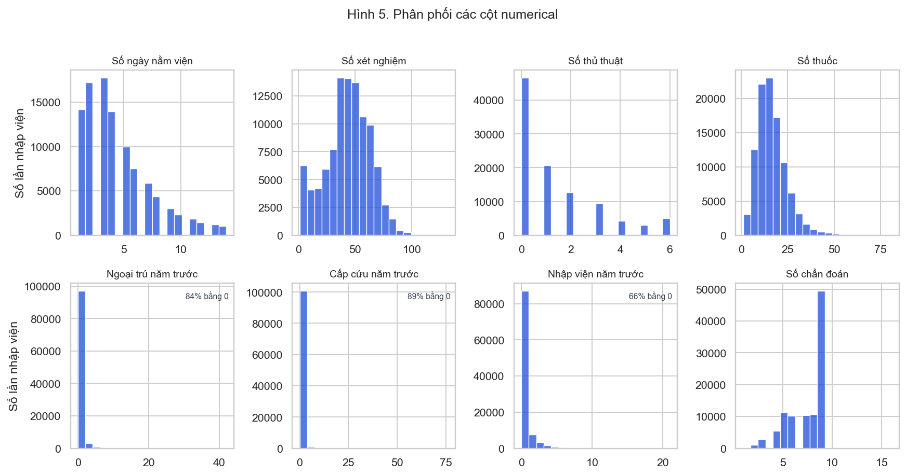
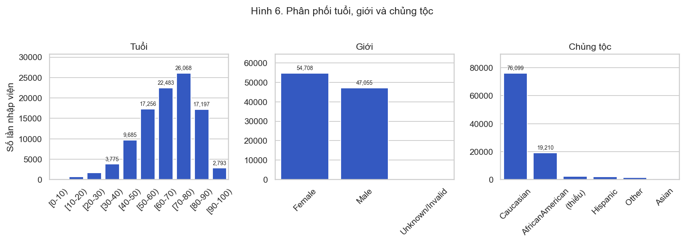
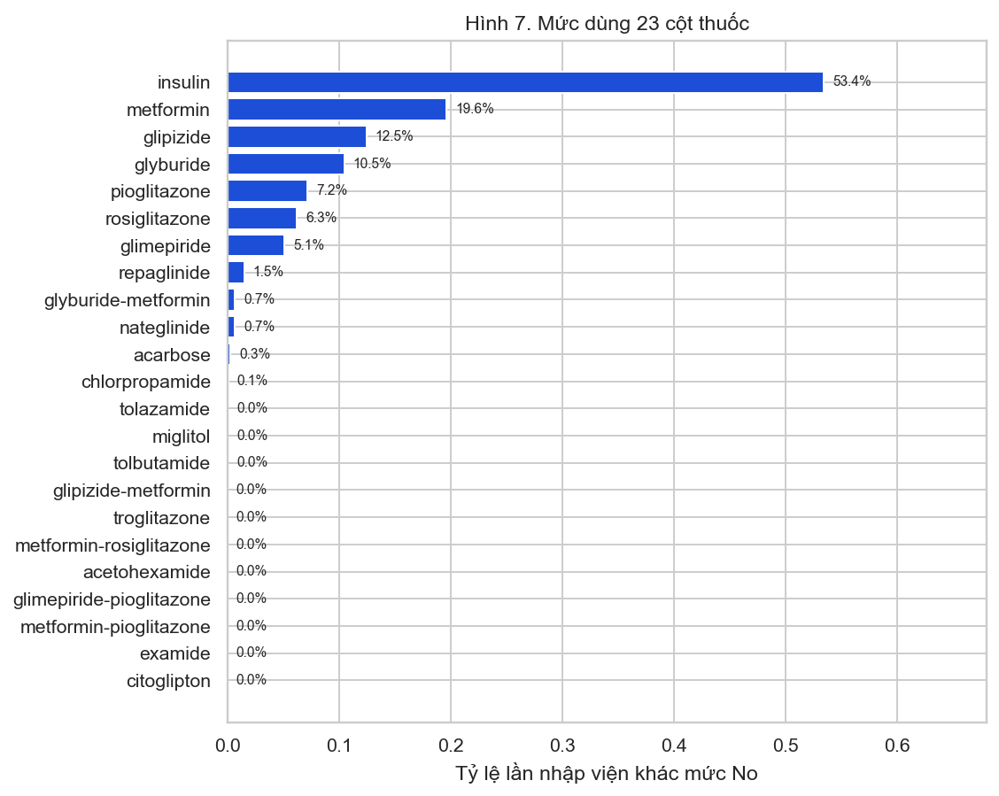
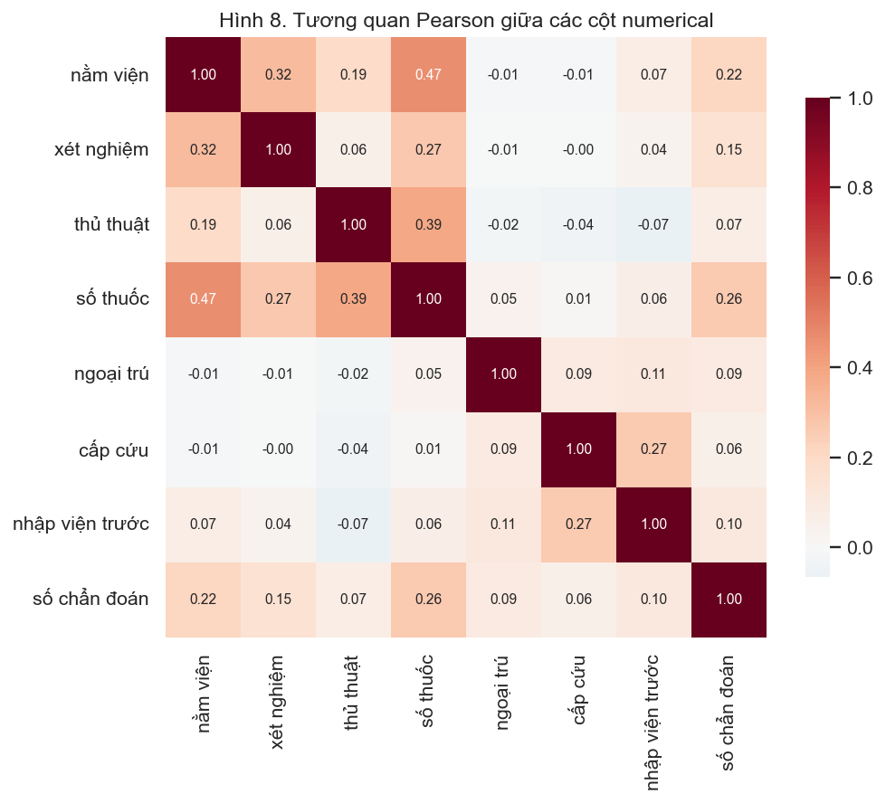
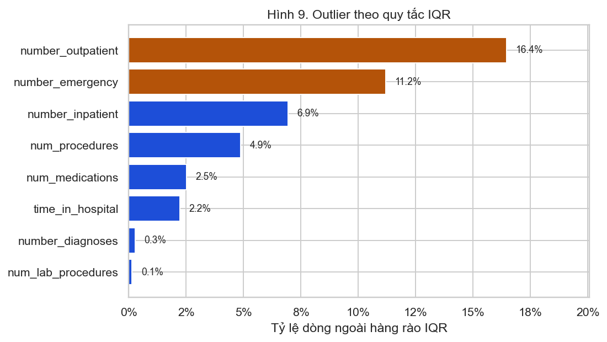
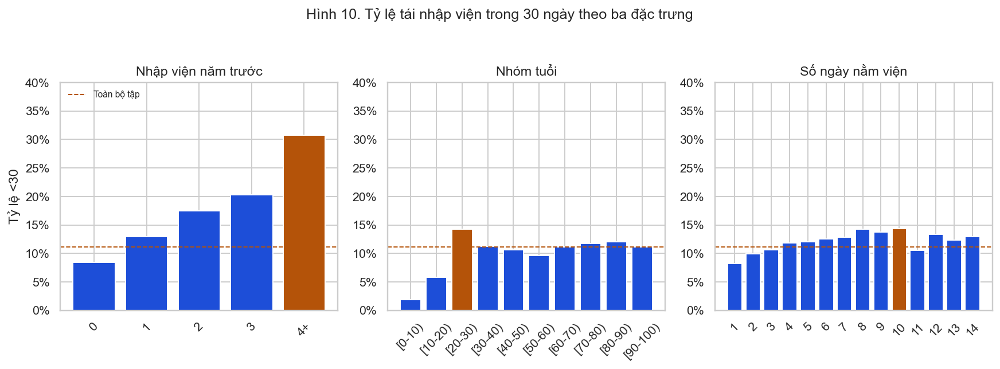

# Dữ liệu bảng — EDA

**Nhóm T&D** · Trần Hữu Anh Triết (2470745), Ngô Minh Đại (2470722)

**Học phần:** Nền tảng lập trình cho phân tích và trực quan dữ liệu · Học kỳ 261, năm học 2026–2027 · Giảng viên Lê Thành Sách

Notebook hoàn tất EDA trên dữ liệu gốc: tổng quan, giá trị thiếu, cân bằng nhãn, phân phối, tương quan, outlier và nhãn theo ba đặc trưng. Chưa xử lý thiếu, chưa encoding, chưa scaling, chưa chia tập và chưa huấn luyện mô hình. Chạy được trên Google Colab: [notebooks/tabular_eda.ipynb](https://github.com/tobitran17-art/CO5177/blob/main/notebooks/tabular_eda.ipynb).

## 1. Bài toán

Một lần nhập viện nội trú của bệnh nhân đái tháo đường có bị tái nhập viện trong vòng 30 ngày hay không?

Nhãn dương là `readmitted == "<30"`. Hai mức còn lại, `>30` và `NO`, là nhãn âm khi làm bài toán nhị phân ở phần sau. Phần EDA này vẫn giữ đủ ba mức để đo độ mất cân bằng của nhãn gốc.

## 2. Tập dữ liệu

**Diabetes 130-US Hospitals for Years 1999–2008**, UCI Machine Learning Repository, dataset 296.

- Trang tập: [archive.ics.uci.edu/dataset/296](https://archive.ics.uci.edu/dataset/296/diabetes+130-us+hospitals+for+years+1999-2008)
- File notebook tải trực tiếp: [data.csv](https://archive.ics.uci.edu/static/public/296/data.csv)
- Điều khoản sử dụng theo trang UCI. Notebook chỉ đọc file công khai, không đóng gói lại bản sao.
- Trích dẫn: Strack, B., DeShazo, J. P., Gennings, C., Olmo, J. L., Ventura, S., Cios, K. J., & Clore, J. N. (2014). *Impact of HbA1c Measurement on Hospital Readmission Rates: Analysis of 70,000 Clinical Database Patient Records.* BioMed Research International, 2014, 781670.

Tập ghi 10 năm chăm sóc nội trú tại 130 bệnh viện Hoa Kỳ. Mỗi dòng là một lần nhập viện, không phải một bệnh nhân. UCI đánh dấu giá trị thiếu bằng `?`.

## 3. Đối chiếu ràng buộc

Đề bài yêu cầu ít nhất 2.000 dòng, ít nhất 10 cột, có giá trị thiếu, có cột categorical để encoding, có cột numerical để scaling, và ưu tiên tập khó.

| Ràng buộc | Yêu cầu | Tập này | Đạt |
| --- | --- | --- | --- |
| Số mẫu | ≥ 2.000 | 101.766 lần nhập viện | Có |
| Số cột | ≥ 10 | 50 cột | Có |
| Giá trị thiếu | Có | 9 cột có thiếu | Có |
| Cột categorical | Có, để encoding sau | 39 cột | Có |
| Cột numerical | Có, để scaling sau | 8 cột | Có |
| Độ khó | Mất cân bằng hoặc outlier | Nhãn `<30` = 11,2%; `number_emergency` tối đa 76; `number_outpatient` tối đa 42 | Có |

`encounter_id` và `patient_nbr` là định danh, không tính vào đặc trưng. Các mã `admission_type_id`, `discharge_disposition_id` và `admission_source_id` là số nguyên nhưng sẽ được encoding như categorical.

## 4. Tổng quan cột

| Vai trò | Số cột | Ví dụ | Việc ở phần sau |
| --- | --- | --- | --- |
| Định danh | 2 | `encounter_id`, `patient_nbr` | Không đưa vào mô hình. `patient_nbr` chỉ dùng để chia tập |
| Nhãn | 1 | `readmitted` | `<30`, `>30`, `NO` |
| Numerical | 8 | `time_in_hospital`, `num_lab_procedures`, `num_medications`, số lần khám | Scaling |
| Categorical | 39 | nhân khẩu, chuyên khoa, ICD-9, 23 cột thuốc | Encoding |

**Kết luận.** Tập đủ cột categorical để encoding và cột numerical để scaling. Hai cột định danh không phải đặc trưng.

## 5. Giá trị thiếu

Chín cột có giá trị thiếu. Ba cột gần như không được đo là `weight`, `max_glu_serum` và `A1Cresult`.

| Cột | Tỷ lệ thiếu | Ghi chú |
| --- | --- | --- |
| `weight` | 96,9% | Nhóm cân nặng, gần như không được ghi |
| `max_glu_serum` | 94,7% | Mã kết quả: Norm, >200, >300 |
| `A1Cresult` | 83,3% | Mã kết quả: Norm, >7, >8 |
| `medical_specialty` | 49,1% | Chuyên khoa bác sĩ |
| `payer_code` | 39,6% | Bên chi trả |
| `race` | 2,2% | Chủng tộc |
| `diag_3` | 1,4% | ICD-9 phụ |
| `diag_2` | 0,35% | ICD-9 phụ |
| `diag_1` | 0,02% | ICD-9 chính |

**Kết luận.** Phần sau sẽ bỏ `weight` vì 96,9% dòng không có giá trị. `max_glu_serum` và `A1Cresult` là mã kết quả xét nghiệm, không phải số liên tục: phần sau giữ hai cột và thêm mức "không xét nghiệm", không điền trung bình. `medical_specialty`, `payer_code`, `race` và các cột `diag_*` cũng thiếu, cách điền để ở bước xử lý sau.

## 6. Cân bằng nhãn

| readmitted | Số lần nhập viện | Tỷ lệ |
| --- | --- | --- |
| `<30` | 11.357 | 11,2% |
| `>30` | 35.545 | 34,9% |
| `NO` | 54.864 | 53,9% |

**Kết luận.** Nhãn `<30` chỉ có 11.357 / 101.766 lần nhập viện (11,2%). Khi gộp `>30` và `NO` thành không tái nhập viện sớm, bài toán nhị phân bị mất cân bằng. Phần mô hình sau không lấy accuracy làm chỉ số chính; cần recall hoặc F1 của lớp `<30`.

## 7. Bệnh nhân lặp

Có 71.518 bệnh nhân cho 101.766 lần nhập viện. 16.773 bệnh nhân có hơn một lần nhập viện. Bệnh nhân cao nhất có 40 lần. Những bệnh nhân này chiếm 46,2% số dòng.

| Số lần nhập viện | Số bệnh nhân |
| --- | --- |
| 1 | 54.745 |
| 2 | 10.434 |
| 3 | 3.328 |
| 4 | 1.421 |
| 5 | 717 |
| 6+ | 873 |

**Kết luận.** Nếu chia train, validation và test theo từng dòng, cùng một bệnh nhân sẽ lọt sang nhiều tập. Phần sau phải chia theo `patient_nbr`.

## 8. Phân phối cột numerical

Tám cột numerical là số ngày hoặc số lần đếm. Ba cột số lần khám năm trước có trung vị bằng 0.

| Cột | Trung vị | Max | Tỷ lệ bằng 0 | Độ lệch |
| --- | --- | --- | --- | --- |
| `time_in_hospital` | 4 | 14 | 0% | 1,13 |
| `num_lab_procedures` | 44 | 132 | 0% | −0,24 |
| `num_procedures` | 1 | 6 | 45,8% | 1,32 |
| `num_medications` | 15 | 81 | 0% | 1,33 |
| `number_outpatient` | 0 | 42 | 83,6% | 8,83 |
| `number_emergency` | 0 | 76 | 88,8% | 22,86 |
| `number_inpatient` | 0 | 21 | 66,5% | 3,61 |
| `number_diagnoses` | 8 | 16 | 0% | −0,88 |

**Kết luận.** `number_emergency` lệch phải rất mạnh (độ lệch 22,9): 88,8% dòng bằng 0 và giá trị lớn nhất là 76. `number_outpatient` có 83,6% dòng bằng 0. `num_lab_procedures` gần đối xứng nhất (độ lệch −0,24). Scaling ở phần sau không thể giả định tám cột này cùng dạng phân phối.

## 9. Phân phối cột categorical

Có 39 cột categorical. `diag_1` có 716 mã ICD-9, nên notebook liệt kê đủ từng cột bằng bảng (số mức, mức phổ biến, tỷ lệ thiếu) thay vì 39 biểu đồ. Hai biểu đồ dưới đây là các cột đọc được.

**Kết luận.** Tuổi tập trung ở `[70-80)` (25,6%, tức 26.068 / 101.766 dòng). `gender` có 3 dòng `Unknown/Invalid`. `insulin` khác mức No ở 53,4% dòng, trong khi 12/23 cột thuốc khác No ở dưới 0,1% dòng. `examide` và `citoglipton` luôn là No, nên phần encoding sau bỏ hai cột này. Mã ICD-9 phổ biến nhất của `diag_1` là `428`, chỉ chiếm 6,7%, nên không one-hot trực tiếp từng mã. `medical_specialty` có 72 mức và thiếu 49,1%.

## 10. Tương quan

**Kết luận.** Cặp cao nhất là `time_in_hospital` và `num_medications`, r = 0,47. Không có cặp numerical nào đạt 0,5, nên chưa có cặp nào cần bỏ vì trùng thông tin. Số lần khám năm trước gần như không tương quan với số ngày nằm viện lần này (|r| lớn nhất là 0,07).

## 11. Outlier

Hàng rào trên của quy tắc IQR là Q3 + 1,5 × IQR. Bước này chỉ đếm, chưa xóa dòng.

| Cột | Hàng rào trên | Số dòng ngoài IQR | Tỷ lệ |
| --- | --- | --- | --- |
| `number_outpatient` | 0 | 16.739 | 16,4% |
| `number_emergency` | 0 | 11.383 | 11,2% |
| `number_inpatient` | 2,5 | 7.049 | 6,9% |
| `num_procedures` | 5 | 4.954 | 4,9% |
| `num_medications` | 35 | 2.557 | 2,5% |
| `time_in_hospital` | 12 | 2.252 | 2,2% |
| `number_diagnoses` | 13,5 | 281 | 0,3% |
| `num_lab_procedures` | 96 | 143 | 0,1% |

**Kết luận.** `number_outpatient` và `number_emergency` có Q1 = Q3 = 0, nên mọi giá trị dương đều bị IQR gọi là outlier. Đó là phân phối đầy số 0, không phải lỗi nhập. `time_in_hospital` chỉ chạy từ 1 đến 14 theo định nghĩa tập; 2.252 dòng trên 12 ngày vẫn nằm trong khoảng này. `num_procedures` chỉ nhận 0–6, và 4,9% dòng bằng 6 bị hàng rào 5 đánh dấu. EDA không xóa các dòng này. Phần chuẩn bị dữ liệu sau giữ chúng.

## 12. Nhãn và ba đặc trưng

Tỷ lệ `<30` trên toàn bộ tập là 11,2%, vẽ bằng đường đứt trên hình 10. Ba đặc trưng đem so là số lần nhập viện năm trước, nhóm tuổi và số ngày nằm viện. Cột tô đậm là mức cao nhất của từng biểu đồ.

| Nhập viện năm trước | Số dòng | Tỷ lệ `<30` |
| --- | --- | --- |
| 0 | 67.630 | 8,4% |
| 1 | 19.521 | 12,9% |
| 2 | 7.566 | 17,4% |
| 3 | 3.411 | 20,3% |
| 4+ | 3.638 | 30,7% |

**Kết luận.** `number_inpatient` gắn với nhãn mạnh nhất trong tám cột numerical (tương quan Pearson với nhãn nhị phân `<30` là 0,165). Tỷ lệ `<30` tăng từ 8,4% khi không nhập viện năm trước lên 30,7% khi nhập từ 4 lần trở lên, gấp 3,6 lần. Tuổi không tăng đơn điệu: nhóm `[20-30)` là 14,2% (1.657 dòng), cao hơn nhóm `[50-60)` là 9,7% (17.256 dòng). `time_in_hospital` yếu hơn: 1 ngày là 8,2% (14.208 dòng), ngày 10 là 14,3% (2.342 dòng), tương quan với nhãn chỉ 0,044. Thêm một điểm cho phần chuẩn bị dữ liệu: 1.642 dòng có `discharge_disposition_id` = 11 đều mang nhãn `NO`. Trong từ điển mã xuất viện của tập, mã 11 là Expired, nên những lần nhập viện này không thể tái nhập. Phần sau sẽ loại chúng trước khi huấn luyện; EDA chưa loại.

## 13. Phần chưa làm

- Bỏ `weight`; thêm mức "không xét nghiệm" cho `max_glu_serum` và `A1Cresult`; xử lý các cột thiếu còn lại.
- Bỏ `examide` và `citoglipton`. Nhóm mã ICD-9 và `medical_specialty` trước khi encoding.
- Loại lần xuất viện expired (`discharge_disposition_id` = 11) trước khi huấn luyện.
- Encoding cột categorical và scaling cột numerical. Giữ các dòng số lần khám lệch phải, không xóa theo IQR.
- Chia train, validation và test theo `patient_nbr`.
- Huấn luyện và so sánh mô hình Scikit-learn, với recall hoặc F1 của lớp `<30`.
