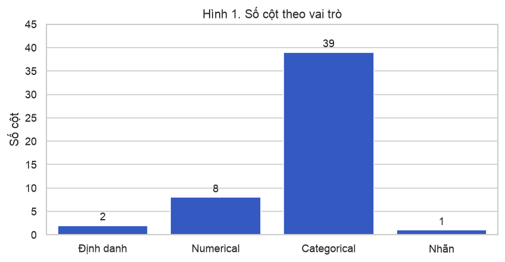
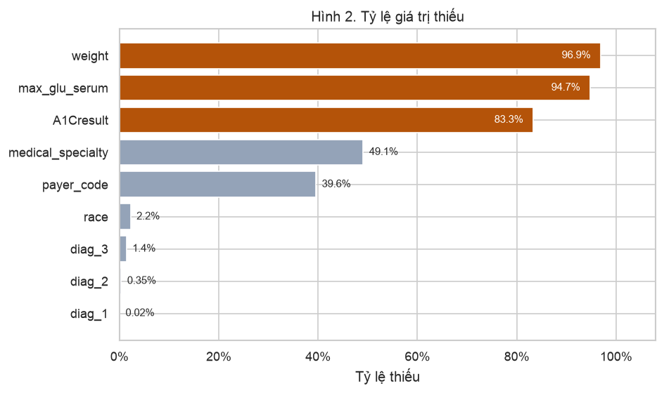
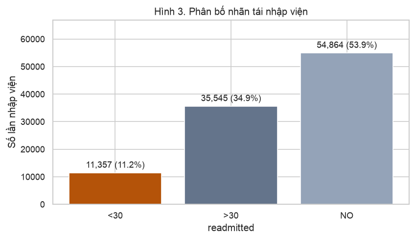
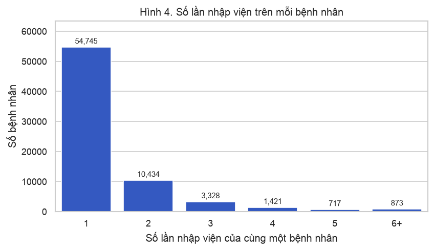

# Dữ liệu bảng — lựa chọn tập dữ liệu và EDA (30%)

**Nhóm T&D** · Trần Hữu Anh Triết (2470745), Ngô Minh Đại (2470722)

**Học phần:** Nền tảng lập trình cho phân tích và trực quan dữ liệu · Học kỳ 261, năm học 2026–2027 · Giảng viên Lê Thành Sách

Checkpoint này chọn tập dữ liệu bảng và làm khoảng 30% EDA: tổng quan, giá trị thiếu, và cân bằng nhãn. Chưa xử lý thiếu, chưa encoding, chưa scaling, chưa chia tập và chưa huấn luyện mô hình. Notebook chạy được trên Google Colab: [notebooks/tabular_eda.ipynb](https://github.com/tobitran17-art/CO5177/blob/main/notebooks/tabular_eda.ipynb).

## 1. Bài toán

Một lần nhập viện nội trú của bệnh nhân đái tháo đường có bị tái nhập viện trong vòng 30 ngày hay không?

Nhãn dương là `readmitted == "<30"`. Hai mức còn lại, `>30` và `NO`, là nhãn âm khi làm bài toán nhị phân ở phần sau. Phần EDA này vẫn giữ đủ ba mức để đo độ mất cân bằng của nhãn gốc.

## 2. Tập dữ liệu

**Diabetes 130-US Hospitals for Years 1999–2008**, UCI Machine Learning Repository, dataset 296.

- Trang tập: [archive.ics.uci.edu/dataset/296](https://archive.ics.uci.edu/dataset/296/diabetes+130-us+hospitals+for+years+1999-2008)
- File notebook tải trực tiếp: [data.csv](https://archive.ics.uci.edu/static/public/296/data.csv)
- Điều khoản sử dụng theo trang UCI. Notebook chỉ đọc file công khai, không đóng gói lại bản sao.
- Trích dẫn: Strack, B., DeShazo, J. P., Gennings, C., Olmo, J. L., Ventura, S., Cios, K. J., & Clore, J. N. (2014). *Impact of HbA1c Measurement on Hospital Readmission Rates: Analysis of 70,000 Clinical Database Patient Records.* BioMed Research International, 2014, 781670.

Tập ghi 10 năm chăm sóc nội trú tại 130 bệnh viện Hoa Kỳ. Mỗi dòng là một lần nhập viện, không phải một bệnh nhân. UCI đánh dấu giá trị thiếu bằng `?`.

### Vì sao không dùng dữ liệu việc làm công nghệ 2026

Stack Overflow đã công bố kết quả tổng hợp Developer Survey 2026 (khoảng 30.900 đáp viên, ngày 6/10/2026), nhưng file từng đáp viên chưa được phát hành. Các bản crawl tin tuyển dụng không có đường dẫn ổn định để chạy lại trên Colab. Tập bệnh viện này tải được ngay, có missing thật, có cột categorical, có cột numerical, và nhãn mất cân bằng.

Mẫu EDA của giảng viên dùng Adult Income. Nhóm không dùng tập đó để tránh trùng mẫu minh họa.

## 3. Đối chiếu ràng buộc

Đề bài yêu cầu ít nhất 2.000 dòng, ít nhất 10 cột, có giá trị thiếu, có cột categorical để encoding, có cột numerical để scaling, và ưu tiên tập khó.

| Ràng buộc | Yêu cầu | Tập này | Đạt |
| --- | --- | --- | --- |
| Số mẫu | ≥ 2.000 | 101.766 lần nhập viện | Có |
| Số cột | ≥ 10 | 50 cột | Có |
| Giá trị thiếu | Có | 9 cột có thiếu | Có |
| Cột categorical | Có, để encoding sau | 39 cột | Có |
| Cột numerical | Có, để scaling sau | 8 cột | Có |
| Độ khó | Mất cân bằng hoặc outlier | Nhãn `<30` = 11,2%; `number_emergency` tối đa 76; `number_outpatient` tối đa 42 | Có |

`encounter_id` và `patient_nbr` là định danh, không tính vào đặc trưng. Các mã `admission_type_id`, `discharge_disposition_id` và `admission_source_id` là số nguyên nhưng sẽ được encoding như categorical.

## 4. Tổng quan cột

| Vai trò | Số cột | Ví dụ | Việc ở phần sau |
| --- | --- | --- | --- |
| Định danh | 2 | `encounter_id`, `patient_nbr` | Không đưa vào mô hình. `patient_nbr` chỉ dùng để chia tập |
| Nhãn | 1 | `readmitted` | `<30`, `>30`, `NO` |
| Numerical | 8 | `time_in_hospital`, `num_lab_procedures`, `num_medications`, số lần khám | Scaling |
| Categorical | 39 | nhân khẩu, chuyên khoa, ICD-9, 23 cột thuốc | Encoding |

**Kết luận.** Tập đủ cột categorical để encoding và cột numerical để scaling. Hai cột định danh không phải đặc trưng.

## 5. Giá trị thiếu

Chín cột có giá trị thiếu. Ba cột gần như không được đo là `weight`, `max_glu_serum` và `A1Cresult`.

| Cột | Tỷ lệ thiếu | Ghi chú |
| --- | --- | --- |
| `weight` | 96,9% | Nhóm cân nặng, gần như không được ghi |
| `max_glu_serum` | 94,7% | Mã kết quả: Norm, >200, >300 |
| `A1Cresult` | 83,3% | Mã kết quả: Norm, >7, >8 |
| `medical_specialty` | 49,1% | Chuyên khoa bác sĩ |
| `payer_code` | 39,6% | Bên chi trả |
| `race` | 2,2% | Chủng tộc |
| `diag_3` | 1,4% | ICD-9 phụ |
| `diag_2` | 0,35% | ICD-9 phụ |
| `diag_1` | 0,02% | ICD-9 chính |

**Kết luận.** Phần sau sẽ bỏ `weight` vì 96,9% dòng không có giá trị. `max_glu_serum` và `A1Cresult` là mã kết quả xét nghiệm, không phải số liên tục: phần sau giữ hai cột và thêm mức "không xét nghiệm", không điền trung bình. `medical_specialty`, `payer_code`, `race` và các cột `diag_*` cũng thiếu, cách điền để ở bước xử lý sau.

## 6. Cân bằng nhãn

| readmitted | Số lần nhập viện | Tỷ lệ |
| --- | --- | --- |
| `<30` | 11.357 | 11,2% |
| `>30` | 35.545 | 34,9% |
| `NO` | 54.864 | 53,9% |

**Kết luận.** Nhãn `<30` chỉ có 11.357 / 101.766 lần nhập viện (11,2%). Khi gộp `>30` và `NO` thành không tái nhập viện sớm, bài toán nhị phân bị mất cân bằng. Phần mô hình sau không lấy accuracy làm chỉ số chính; cần recall hoặc F1 của lớp `<30`.

## 7. Bệnh nhân lặp

Có 71.518 bệnh nhân cho 101.766 lần nhập viện. 16.773 bệnh nhân có hơn một lần nhập viện. Bệnh nhân cao nhất có 40 lần. Những bệnh nhân này chiếm 46,2% số dòng.

| Số lần nhập viện | Số bệnh nhân |
| --- | --- |
| 1 | 54.745 |
| 2 | 10.434 |
| 3 | 3.328 |
| 4 | 1.421 |
| 5 | 717 |
| 6+ | 873 |

**Kết luận.** Nếu chia train, validation và test theo từng dòng, cùng một bệnh nhân sẽ lọt sang nhiều tập. Phần sau phải chia theo `patient_nbr`.

## 8. Phần chưa làm

- Phân phối từng cột numerical và categorical.
- Ma trận tương quan.
- Xử lý outlier của các cột số lần khám (`number_emergency` tối đa 76, `number_outpatient` tối đa 42, trung vị đều bằng 0).
- So sánh nhãn với 2–3 đặc trưng.
- Bỏ `weight`, thêm mức "không xét nghiệm" cho glucose và HbA1c, xử lý các cột thiếu còn lại.
- Encoding cột categorical và scaling cột numerical.
- Chia train, validation và test theo `patient_nbr`.
- Huấn luyện và so sánh mô hình Scikit-learn.
