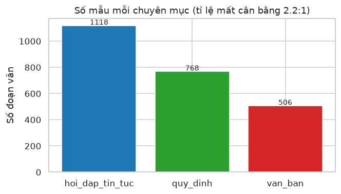
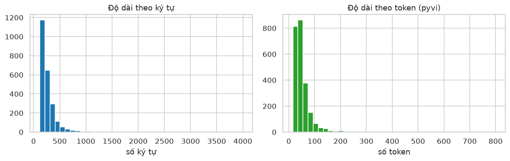
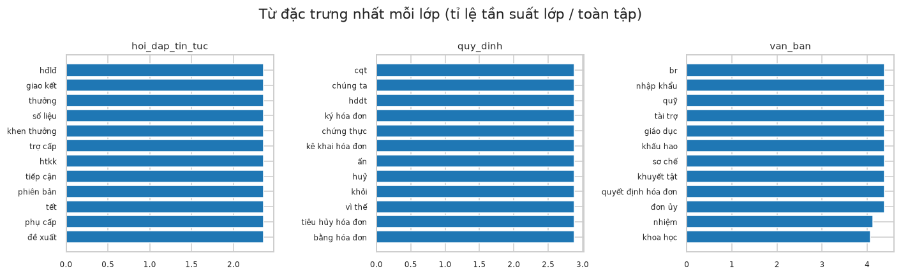
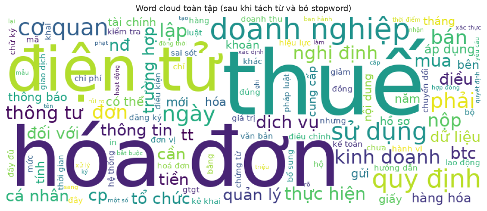
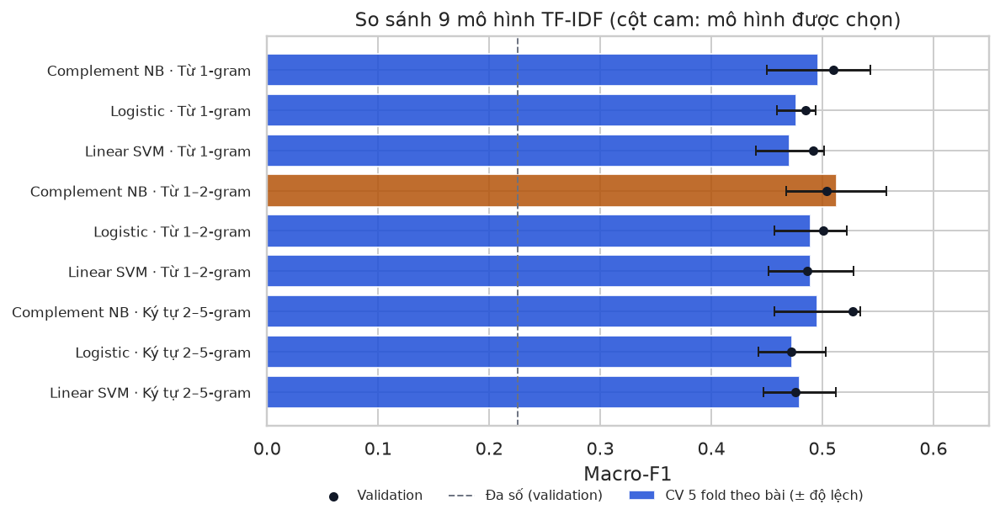
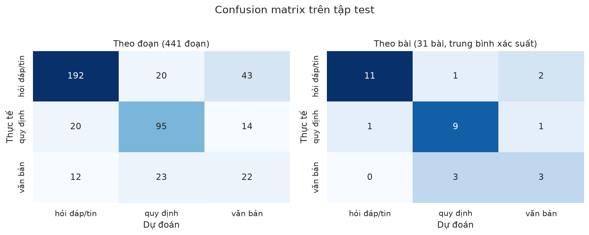
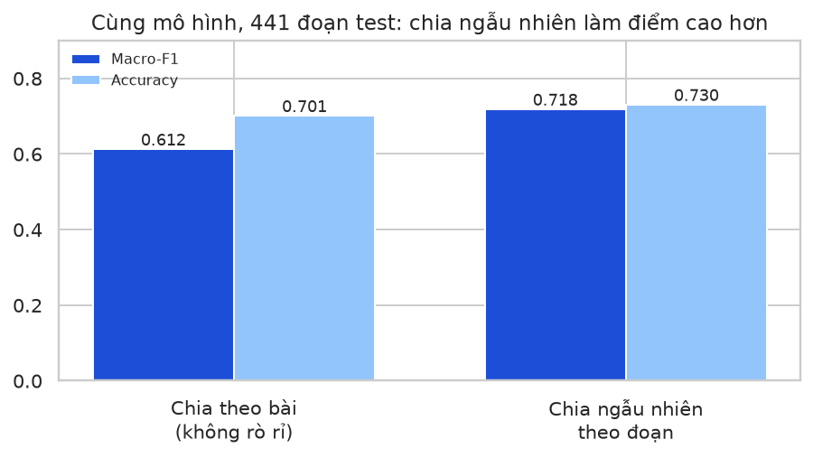
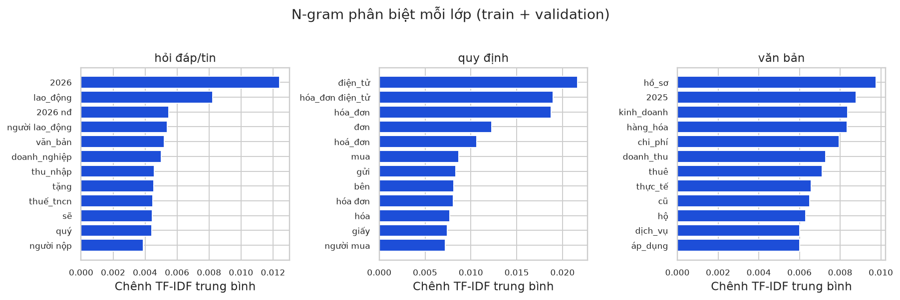

# Dữ liệu văn bản — EDA và mô hình

**Nhóm T&D** · Trần Hữu Anh Triết (2470745), Ngô Minh Đại (2470722)

**Học phần:** Nền tảng lập trình cho phân tích và trực quan dữ liệu · Học kỳ 261, năm học 2026–2027 · Giảng viên Lê Thành Sách

Notebook hoàn tất EDA, chuẩn bị dữ liệu và so sánh mô hình Scikit-learn cho bài phân loại đoạn văn thuế – hoá đơn điện tử tiếng Việt theo chuyên mục. Notebook chạy được trên Google Colab (Run all).

**Liên kết:** [Notebook trên GitHub](https://github.com/tobitran17-art/CO5177/blob/main/notebooks/text_eda.ipynb) · [Mở trên Google Colab](https://colab.research.google.com/github/tobitran17-art/CO5177/blob/main/notebooks/text_eda.ipynb)

## 1. Bài toán

Cho một **đoạn văn** về thuế – hoá đơn điện tử, dự đoán nó thuộc **chuyên mục** nào trong ba lớp: `hoi_dap_tin_tuc` (hỏi–đáp, tin chính sách, tình huống), `quy_dinh` (cách lập/gửi/lưu trữ/điều chỉnh/xử lý sai sót hoá đơn), `van_ban` (diễn giải Nghị định/Thông tư). Đây là bài toán **phân loại văn bản tiếng Việt đa lớp**.

## 2. Tập dữ liệu

Tập **tự thu thập và biên tập**: các bài viết tri thức thuế – kế toán – hoá đơn điện tử tiếng Việt, đã làm sạch (bỏ HTML, quảng cáo, thông tin thương hiệu) và tách thành **đoạn văn**. Mỗi đoạn là một mẫu, nhãn là chuyên mục của bài gốc. Không chứa thông tin cá nhân/định danh — chỉ là nội dung quy định công khai. File dữ liệu công khai trong repo: `notebooks/data/text_corpus.csv`.

## 3. Đối chiếu ràng buộc

| Ràng buộc | Yêu cầu | Tập này | Đạt |
| --- | --- | --- | --- |
| Số mẫu | ≥ 2.000 | 2.392 đoạn | Có |
| Ngôn ngữ | Ưu tiên tiếng Việt | Tiếng Việt | Có |
| Tự thu thập | Khuyến khích | Crawl + biên tập | Có |
| Số lớp | ≥ 2 (phân loại) | 3 lớp | Có |

## 4. Cân bằng nhãn

| Chuyên mục | Số đoạn | Tỷ lệ |
| --- | --- | --- |
| `hoi_dap_tin_tuc` | 1.118 | 46,7% |
| `quy_dinh` | 768 | 32,1% |
| `van_ban` | 506 | 21,2% |

**Kết luận.** Lớp lớn nhất gấp 2,2 lần lớp nhỏ nhất. Phần mô hình dùng **macro-F1** thay cho accuracy, và các mô hình tuyến tính dùng `class_weight` để không thiên về lớp đông.

## 5. Phân phối độ dài

Độ dài đoạn lệch phải: trung vị 220 ký tự (≈ 43 token theo `pyvi`), nhưng có đoạn tới 3.989 ký tự (≈ 799 token).

**Kết luận.** Phân phối lệch phải → khi vector hoá nên giới hạn `max_features` của TF-IDF và loại các đoạn quá ngắn (đã lọc đoạn < 120 ký tự).

## 6. Trùng lặp

Chỉ **5 đoạn trùng y hệt** (0,2%), không có đoạn rỗng.

**Kết luận.** Khử 5 đoạn trùng trước khi chia tập để tránh rò rỉ dữ liệu (data leakage) giữa train và test.

## 7. Từ vựng và từ phân biệt lớp

Từ vựng (sau khi tách từ `pyvi` và bỏ stopword) có **2.935 từ**. Những từ phổ biến nhất — "thuế", "hóa đơn", "điện tử", "doanh nghiệp", "quy định" — xuất hiện ở mọi lớp, cho thấy ranh giới lớp **chồng lấn**.

**Kết luận.** Mỗi lớp có nhóm từ riêng nhưng từ chung phủ khắp → cần TF-IDF để hạ trọng số từ phổ biến; đây là bài toán có độ khó thực, không tầm thường.

## 8. Chuẩn bị dữ liệu

- Khử 5 đoạn trùng y hệt. Còn 2.387 đoạn từ 206 bài.
- Làm sạch: bỏ ký hiệu Markdown, gộp khoảng trắng, chữ thường. Giữ số hiệu văn bản như `70/2025` vì đó là tín hiệu của lớp `van_ban`.
- Tách từ bằng `pyvi`; từ ghép nối bằng `_` (`hóa_đơn`).
- **Chia theo bài** (`post_id`), 70% / 15% / 15%, stratify theo chuyên mục của bài. Mỗi bài chỉ thuộc một chuyên mục, và các đoạn của một bài giống nhau về chủ đề và cách viết, nên không bài nào được nằm ở hai tập.
- TF-IDF nằm trong `Pipeline`, chỉ fit trên dữ liệu huấn luyện của từng lần chạy.

| Tập | Số đoạn | Số bài | `hoi_dap_tin_tuc` | `quy_dinh` | `van_ban` |
| --- | --- | --- | --- | --- | --- |
| Train | 1.580 | 144 | 42,7% | 33,4% | 23,9% |
| Validation | 366 | 31 | 51,1% | 30,1% | 18,9% |
| Test | 441 | 31 | 57,8% | 29,3% | 12,9% |

**Kết luận.** Tỷ lệ lớp theo đoạn lệch giữa các tập vì mỗi bài có số đoạn khác nhau (1 đến 59 đoạn). Test có ít đoạn `van_ban` hơn train.

## 9. So sánh mô hình

Ba cách biểu diễn TF-IDF ghép với ba mô hình Scikit-learn. Validation chỉ có 31 bài, nên mô hình được chọn theo trung bình **5-fold cross-validation trên train + validation, chia theo bài** (`StratifiedGroupKFold`). Test không dùng ở bước này.

| Biểu diễn | Mô hình | Accuracy val | Macro-F1 val | Macro-F1 CV (± độ lệch) |
| --- | --- | --- | --- | --- |
| — | Đa số (luôn `hoi_dap_tin_tuc`) | 0,511 | 0,225 | — |
| Từ 1-gram | Complement NB | 0,538 | 0,510 | 0,496 ± 0,047 |
| Từ 1-gram | Logistic, `class_weight` | 0,536 | 0,485 | 0,476 ± 0,017 |
| Từ 1-gram | Linear SVM, `class_weight` | 0,544 | 0,492 | 0,471 ± 0,031 |
| **Từ 1–2-gram** | **Complement NB** | **0,552** | **0,504** | **0,513 ± 0,045** |
| Từ 1–2-gram | Logistic, `class_weight` | 0,560 | 0,501 | 0,489 ± 0,033 |
| Từ 1–2-gram | Linear SVM, `class_weight` | 0,552 | 0,486 | 0,490 ± 0,038 |
| Ký tự 2–5-gram | Complement NB | 0,579 | 0,528 | 0,496 ± 0,039 |
| Ký tự 2–5-gram | Logistic, `class_weight` | 0,522 | 0,472 | 0,473 ± 0,030 |
| Ký tự 2–5-gram | Linear SVM, `class_weight` | 0,530 | 0,476 | 0,479 ± 0,032 |

**Kết luận.** Mọi mô hình đều vượt mốc đa số (macro-F1 0,225). Chín mô hình chỉ cách nhau 0,042 macro-F1 CV, khoảng một độ lệch chuẩn giữa các fold, nên chọn biểu diễn hay mô hình nào cũng không đổi kết quả nhiều. Mô hình được chọn là Complement NB trên TF-IDF từ 1–2-gram (CV 0,513). Ký tự 2–5-gram với Complement NB có validation cao nhất (0,528) nhưng CV thấp hơn, nên không được chọn.

## 10. Kết quả trên test

Mô hình đã chọn được huấn luyện lại trên train + validation và chấm một lần trên test. Ngoài chấm theo đoạn, notebook chấm **theo bài**: trung bình xác suất các đoạn của một bài, chọn lớp cao nhất.

| Lớp | Precision | Recall | F1 | Số đoạn |
| --- | --- | --- | --- | --- |
| `hoi_dap_tin_tuc` | 0,857 | 0,753 | 0,802 | 255 |
| `quy_dinh` | 0,688 | 0,736 | 0,712 | 129 |
| `van_ban` | 0,278 | 0,386 | 0,324 | 57 |
| Macro | 0,608 | 0,625 | **0,612** | 441 |

| Cách chấm | Accuracy | Macro-F1 |
| --- | --- | --- |
| Theo đoạn (441 đoạn) | 0,701 | 0,612 |
| Theo bài (31 bài) | 0,742 (23/31) | 0,699 |

**Kết luận.** `van_ban` là lớp yếu nhất (F1 0,324): 23 trong 57 đoạn `van_ban` bị đoán là `quy_dinh`. Gộp các đoạn của một bài sửa được nhiều lỗi lẻ, macro-F1 tăng từ 0,612 lên 0,699.

## 11. Chia theo bài so với chia ngẫu nhiên

Cùng mô hình, cùng 441 đoạn test, chỉ khác cách chia: chia theo bài như mục 8, hoặc chia ngẫu nhiên theo đoạn.

**Kết luận.** Chia ngẫu nhiên theo đoạn cho macro-F1 0,718, cao hơn 0,106 so với chia theo bài (0,612), vì mọi đoạn test đều thuộc bài đã có đoạn trong train. Chênh lệch này lớn hơn khoảng cách giữa chín mô hình ở mục 9 (0,042): cách chia tập đổi kết quả nhiều hơn cách chọn mô hình.

## 12. N-gram phân biệt lớp và ví dụ bị gán sai

132 trong 441 đoạn test (29,9%) bị gán sai. Lỗi tự tin nhất của mỗi cặp (thực tế → dự đoán):

| Thực tế | Dự đoán | Xác suất | Đoạn (rút gọn) |
| --- | --- | --- | --- |
| văn bản | quy định | 0,96 | Trường hợp doanh nghiệp lập hóa đơn điện tử bị sai (gọi là hóa đơn F0), sau đó doanh nghiệp lập hóa đơn điều chỉnh hoặc thay thế… |
| quy định | hỏi đáp/tin | 0,95 | Nghị định 255/2026/NĐ-CP quy định về quản lý thuế đối với các giao dịch liên kết của những doanh nghiệp có quan hệ liên kết… |
| hỏi đáp/tin | văn bản | 0,89 | Xác định rõ vai trò của kinh tế tư nhân: Là động lực quan trọng trong nền kinh tế quốc gia… |
| văn bản | hỏi đáp/tin | 0,72 | Người nộp thuế khai TNCN theo tháng nhưng đủ điều kiện khai thuế GTGT theo quý → được lựa chọn khai TNCN theo quý… |
| quy định | văn bản | 0,66 | Nghị định này có hiệu lực từ ngày 05/03/2026, đưa ra nhiều thay đổi quan trọng về ngưỡng doanh thu chịu thuế… |
| hỏi đáp/tin | quy định | 0,61 | 6 tỉnh triển khai hoá đơn điện tử giai đoạn 1 chiếm tỷ lệ tới 60 – 70% số lượng hóa đơn… |

**Kết luận.** `quy_dinh` được nhận ra qua nhóm từ về hoá đơn (`hóa_đơn điện_tử`, `người mua`, `gửi`). N-gram mạnh nhất của hai lớp còn lại là năm: `2026` cho hỏi đáp/tin, `2025` cho văn bản, nên mô hình học cả thời điểm đăng bài. Một phần lỗi đến từ nhãn: nhãn là chuyên mục của cả bài, nên đoạn hướng dẫn lập hoá đơn điều chỉnh ở dòng đầu, nằm trong một bài diễn giải nghị định, vẫn mang nhãn `van_ban`. Nội dung đoạn đó đúng là "quy định", và mô hình gán nó vào `quy_dinh` với xác suất 0,96.

## 13. Tổng kết

Mọi mô hình TF-IDF đều vượt mốc đa số, nhưng khác nhau ít. Mô hình được chọn đạt macro-F1 0,612 trên test theo đoạn và 0,699 theo bài. Lớp `van_ban` khó nhất, vì đoạn diễn giải văn bản thường nói đúng nội dung của một quy định. Chia theo bài là bắt buộc: chia ngẫu nhiên theo đoạn làm macro-F1 cao thêm 0,106.

Hạn chế: validation và test mỗi tập chỉ có 31 bài, nên điểm dao động theo vài bài; nhãn mức bài được gán cho từng đoạn; mô hình dựa một phần vào năm đăng bài. Hướng mở rộng: phân loại ở mức bài; gán lại nhãn mức đoạn cho một mẫu nhỏ để đo tỷ lệ nhiễu nhãn; bỏ số năm khỏi đặc trưng để đo phần mô hình dựa vào nội dung.
