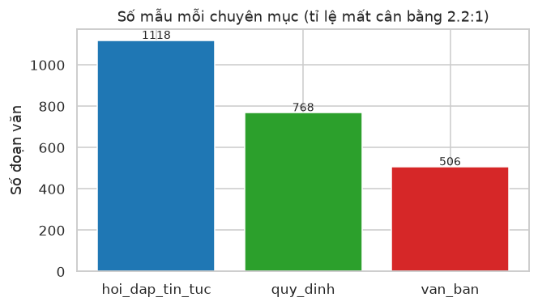
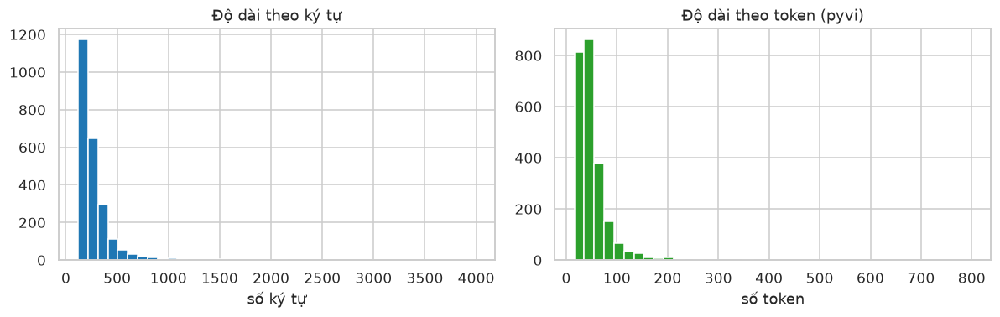
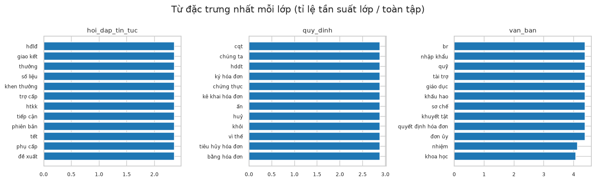
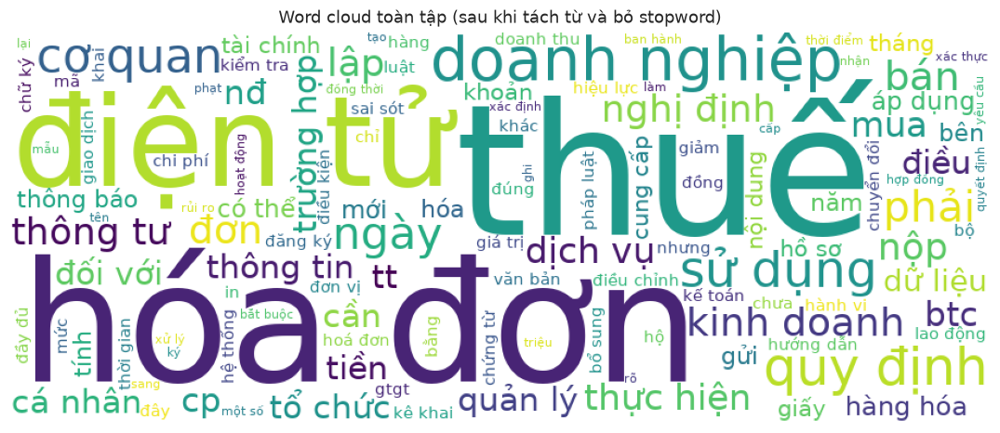

# Dữ liệu văn bản — lựa chọn tập dữ liệu và EDA

**Nhóm T&D** · Trần Hữu Anh Triết (2470745), Ngô Minh Đại (2470722)

**Học phần:** Nền tảng lập trình cho phân tích và trực quan dữ liệu · Học kỳ 261, năm học 2026–2027 · Giảng viên Lê Thành Sách

Checkpoint này chọn tập dữ liệu văn bản tiếng Việt và làm phần EDA: mô tả tập, đối chiếu ràng buộc, cân bằng nhãn, phân phối độ dài, trùng lặp, và từ vựng phân biệt lớp. Chưa vector hoá, chưa huấn luyện mô hình. Notebook chạy được trên Google Colab (Run all).

**Liên kết:** [Notebook trên GitHub](https://github.com/tobitran17-art/CO5177/blob/main/notebooks/text_eda.ipynb) · [Mở trên Google Colab](https://colab.research.google.com/github/tobitran17-art/CO5177/blob/main/notebooks/text_eda.ipynb) · PDF report và video trình bày sẽ cập nhật.

## 1. Bài toán

Cho một **đoạn văn** về thuế – hoá đơn điện tử, dự đoán nó thuộc **chuyên mục** nào trong ba lớp: `hoi_dap_tin_tuc` (hỏi–đáp, tin chính sách, tình huống), `quy_dinh` (cách lập/gửi/lưu trữ/điều chỉnh/xử lý sai sót hoá đơn), `van_ban` (diễn giải Nghị định/Thông tư). Đây là bài toán **phân loại văn bản tiếng Việt đa lớp**.

## 2. Tập dữ liệu

Tập **tự thu thập và biên tập**: các bài viết tri thức thuế – kế toán – hoá đơn điện tử tiếng Việt, đã làm sạch (bỏ HTML, quảng cáo, thông tin thương hiệu) và tách thành **đoạn văn**. Mỗi đoạn là một mẫu, nhãn là chuyên mục của bài gốc. Không chứa thông tin cá nhân/định danh — chỉ là nội dung quy định công khai. File dữ liệu công khai trong repo: `notebooks/data/text_corpus.csv`.

## 3. Đối chiếu ràng buộc

| Ràng buộc | Yêu cầu | Tập này | Đạt |
| --- | --- | --- | --- |
| Số mẫu | ≥ 2.000 | 2.392 đoạn | Có |
| Ngôn ngữ | Ưu tiên tiếng Việt | Tiếng Việt | Có |
| Tự thu thập | Khuyến khích | Crawl + biên tập | Có |
| Số lớp | ≥ 2 (phân loại) | 3 lớp | Có |

## 4. Cân bằng nhãn

| Chuyên mục | Số đoạn | Tỷ lệ |
| --- | --- | --- |
| `hoi_dap_tin_tuc` | 1.118 | 46,7% |
| `quy_dinh` | 768 | 32,1% |
| `van_ban` | 506 | 21,2% |

**Kết luận.** Lớp lớn nhất gấp 2,2 lần lớp nhỏ nhất. Phần mô hình sau dùng **macro-F1** thay cho accuracy và cân nhắc `class_weight` để không thiên về lớp đông.

## 5. Phân phối độ dài

Độ dài đoạn lệch phải: trung vị 220 ký tự (≈ 43 token theo `pyvi`), nhưng có đoạn tới 3.989 ký tự (≈ 799 token).

**Kết luận.** Phân phối lệch phải → khi vector hoá nên giới hạn `max_features` của TF-IDF và loại các đoạn quá ngắn (đã lọc đoạn < 120 ký tự).

## 6. Trùng lặp

Chỉ **5 đoạn trùng y hệt** (0,2%), không có đoạn rỗng.

**Kết luận.** Khử 5 đoạn trùng trước khi chia tập để tránh rò rỉ dữ liệu (data leakage) giữa train và test.

## 7. Từ vựng và từ phân biệt lớp

Từ vựng (sau khi tách từ `pyvi` và bỏ stopword) có **2.935 từ**. Những từ phổ biến nhất — "thuế", "hóa đơn", "điện tử", "doanh nghiệp", "quy định" — xuất hiện ở mọi lớp, cho thấy ranh giới lớp **chồng lấn**.

**Kết luận.** Mỗi lớp có nhóm từ riêng nhưng từ chung phủ khắp → cần TF-IDF để hạ trọng số từ phổ biến; đây là bài toán có độ khó thực, không tầm thường.

## 8. Phần chưa làm

- Vector hoá TF-IDF (so với embedding), chia train/val/test giữ phân bố lớp.
- Huấn luyện mô hình cơ bản (Logistic Regression, Linear SVM) với `class_weight`.
- Confusion matrix kèm ví dụ bị gán sai; so sánh TF-IDF với embedding.
